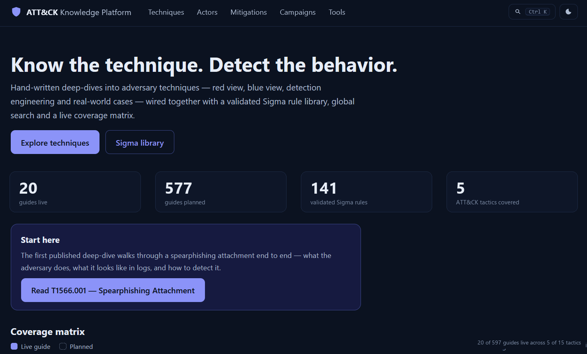

# ATT&CK Knowledge Platform

[](https://github.com/Souhaieb-Marzouk/attack-knowledge-platform/actions/workflows/sigma-validate.yml)
[](https://souhaieb-marzouk.github.io/attack-knowledge-platform/)
[](LICENSE)

> **The bridge between attack.mitre.org and a junior analyst's first Monday.**
> 20 hand-written technique deep-dives, 597 tracked ATT&CK techniques, 141
> CI-validated Sigma rules, and a log test for every rule.

**Live site:** https://souhaieb-marzouk.github.io/attack-knowledge-platform/



*The home page coverage matrix. Live guides are filled; the full ATT&CK
catalogue is one toggle away.*

## What is this?

An unofficial, educational knowledge base for MITRE ATT&CK®. Every live guide
explains a technique from both sides: how an attacker uses it, and how a
defender sees it in logs. The platform adds the parts a static page cannot:
a 15-tactic coverage matrix, hub pages, global search, cross-links, a Sigma
rule library, and a detection-as-code pipeline that validates every rule and
runs it against positive and negative log fixtures.

The site is plain HTML, CSS and vanilla JavaScript. No framework, no build
step, no external runtime dependency. Hosting is GitHub Pages; CI is GitHub
Actions; both are free for public repositories.

## What is inside

| Area | Today |
|---|---|
| Live technique guides | **20** hand-written deep-dives (red view, blue view, detection engineering, case study, mitigations, mistakes) |
| ATT&CK catalogue | **597** techniques across **15** tactics (the current Stealth / Defense Impairment model) |
| Threat intelligence data | **180** actors, **44** mitigations, **59** campaigns |
| Sigma library | **141** rules, every one passing `sigma check` + Splunk conversion |
| Log tests | **141** positive and **141** negative JSONL cases, one pair per rule |
| CI | data validation, case-exact paths, page integration, link check, site consistency, Sigma schema + conversion + log tests |

## The five platform features

- **Ctrl+K global search** across techniques, actors, mitigations, campaigns
  and Sigma rules. Inverted index, ranked results, full keyboard navigation,
  and live guides ranked above catalogue rows.
- **ATT&CK matrix heatmap** with 15 tactic columns and a live/full-catalogue
  toggle, so the roadmap never buries the 20 guides that are ready to read.
- **Cross-linked guides** with breadcrumbs, relations (used by / mitigated by /
  detected by) and prev/next within the tactic.
- **Sigma Rule Library** with level, logsource, tactics, linked technique,
  filters and Copy YAML.
- **Detection-as-code CI** with schema validation, Splunk conversion, positive
  and negative log tests, and an auto-generated index.

Plus three supporting tools:

- **Detection coverage** — per-tactic coverage and the live-guide coverage
  number, computed from the same JSON.
- **False-positive gallery** — curated benign triggers with tuning decisions.
- **Sigma authoring guide** — a standalone HTML handbook for writing and
  testing rules: [`docs/sigma-rule-guide.html`](docs/sigma-rule-guide.html).

## How it works

```
data/*.json ──► platform.js ──► home matrix, hubs, breadcrumbs, relations
     │                 │
     │                 └─► search.js (inverted index, Ctrl+K)
     │
     ├─► sigma-index.json ◄── build_sigma_index.py ◄── sigma/rules/*.yml
     │                                                   │
     └─► techniques/*.html ◄── 4-line integration block ─┘
                                                       │
tests/sigma_cases/*.jsonl ◄── generate_fixtures.py ────┘
     │
     └─► test_sigma.py (schema + conversion + positive/negative logs)
```

Every technique links through its row in `data/techniques.json`; no page path
is hard-coded in the renderer. The same data drives the matrix, hubs, search,
prev/next and the coverage page.

## Quality gates

Run these from the repository root (Python 3.10+):

```powershell
py scripts/validate_data.py
py scripts/check_links.py
py scripts/check_site.py
py tests/test_sigma.py
```

The first three are plain Python. The Sigma gate needs the toolchain:

```powershell
py -m venv .venv
.venv\Scripts\activate
pip install sigma-cli pySigma-backend-splunk pyyaml
python tests/test_sigma.py
```

CI runs the same commands on every push and pull request. The workflow also
rebuilds `data/sigma-index.json` and commits it back to `main` with
`[skip ci]`, so the library page is always in sync with the rule folder.

## Repository map

```
├── index.html                     # home + live/all matrix
├── 404.html                       # search-first 404
├── techniques/                    # 20 guides + hub + _template.html
├── actors/ mitigations/ campaigns/# relationship hubs
├── tools/                         # sigma library, coverage, false positives
├── docs/sigma-rule-guide.html     # standalone authoring/testing handbook
├── assets/                        # platform CSS/JS + screenshots/social card
├── data/                          # JSON single source of truth
├── sigma/rules/                   # 141 validated rules
├── tests/                         # log fixtures + matcher + CI gate
├── scripts/                       # validators, index builder, link/site checks
└── .github/workflows/             # Quality Gate
```

## Add a technique or a rule

- [CONTRIBUTING.md](CONTRIBUTING.md) — the two workflows, the integration
  block, the quality gates, and the PR checklist.
- [data/README.md](data/README.md) — the JSON schema and how to promote a
  planned row to a live guide.
- [sigma/README.md](sigma/README.md) — the rule style guide, test policy and
  fixture format.
- [techniques/_template.html](techniques/_template.html) — the empty shell to
  copy for a new guide.

## Roadmap

- [ ] Actor dossiers for the top 10 tracked groups.
- [ ] Campaign pages with technique timelines.
- [ ] Auto-sync `data/` from the official ATT&CK STIX release, with a drift
      issue when a tracked technique changes.
- [ ] Learning paths and per-technique quizzes.
- [ ] Service-worker offline mode.

The public issue tracker is the source of truth for the roadmap; open an issue
with the `future-feature` label.

## Attribution

MITRE ATT&CK® is a registered trademark of The MITRE Corporation. This project
is unofficial and educational; technique identifiers and descriptions reference
the public MITRE ATT&CK knowledge base (mitre/cti) and are used with
attribution. Content on this site is the author's own analysis and does not
represent MITRE.

## License

MIT — see [LICENSE](LICENSE) and [NOTICE](NOTICE).
